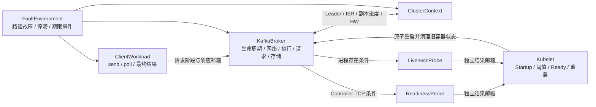

# M0-R2 结构与建模约束

## 七个角色与四层关系

仍保留 ReadinessProbe、LivenessProbe、Kubelet、KafkaBroker、ClientWorkload、FaultEnvironment、ClusterContext 七个角色。按本次模型语义，业务调用由 ClientWorkload 表示，Kafka 服务由 KafkaBroker 与 ClusterContext 表示，健康观测由两个 Probe 表示，容器控制由 Kubelet 表示；FaultEnvironment 横跨这些行为。这里的角色划分没有把跨层关系压成一个“服务正常”布尔量。



模型分为 `State → Role → System → Check` 四种文件职责。它们是文件组织层次，不是论文中的系统层次。

## 并行、通信与原子性

使用 CSP# 的 `|||` 交错并行组合角色。通信通过显式共享状态：一槽探针结果邮箱 `rp_result/lp_result`、响应邮箱 `rx`、请求阶段 `bp`。每个 `event{...}` 是一次原子转移；事件守卫与赋值一起描述可执行步骤。这样消除旧模型中“纯事件握手之后再单独记录状态”的中间窗口，避免 PAT 将带赋值事件排除同步后造成错误组合。

这是一种新的有限状态抽象，**没有声明它与旧 CSP 模型双向等价，也没有声称覆盖全部实现轨迹**。适用性质和删去的行为分别在下文列明。

少数 `checks` 入口增加 `Observed() = M0() ||| 观察器`，记录反例要求的先后顺序。观察器不写角色变量，不同步或禁止角色事件；其自身记录步骤也不能当作源码中的业务步骤。对应完整原始路径会显示 `observe_*` 事件。

| 状态 | 正常写入者 | 跨角色关系 |
|---|---|---|
| `life` | Broker 生命周期、环境进程退出 | Kubelet 重启统一重置；探针读取 |
| `rp_result/lp_result` | 对应 Probe 写入，Kubelet 消费清空 | 邮箱满时该探针等待，另一探针仍可执行 |
| `started/ready/*_fail` | Kubelet | FaultEnvironment 不直接设置健康结果 |
| `bp/response` | Broker | Client 仅在收到可重试错误后释放一次重试；Kubelet 取消旧请求 |
| `rx/client/*expired` | 网络发送写 `rx`，Client 形成结果，环境产生期限事件 | Broker 成功与应用成功保留不同步骤 |
| ISR、两个 ACK、HW | ClusterContext | Broker 根据这些条件接受追加、形成响应 |
| 路径及执行条件 | FaultEnvironment | 重启仅恢复容器内执行，不自动修复外部链路和磁盘 |

保留的关键原子边界：

1. `b_io_begin` 同时检查 Leader/minISR，并进入持有 `leaderIsrUpdateLock` 读锁的 I/O 阶段。`bp=3` 时禁止 ISR 与 Leader 的写锁更新；磁盘挂起可延长此阶段。
2. `b_io_complete` 释放此读锁。Fetch 不会在读操作尚未结束时返回非 Leader 错误而遗留一个永远无人消费的读完成事件。
3. `cc_high_watermark` 与 `b_produce_ok/b_after_append_error` 分离。HW 已越过选中记录之后，当前 ISR 可以发生变化，随后响应判定使用源码的当前条件。
4. `b_deliver` 独立于响应形成，必须满足客户端链路条件。已形成的成功响应可以滞留到客户端超时之后。
5. `k_restart` 压缩一次旧容器清理与代际切换，清空旧探针邮箱/请求阶段。独立客户端已收到的响应和结果不被重启抹去。

## 分区复制抽象

固定目标分区、本地节点 0，初始 Leader 本地、ISR `{0,1,2}`，最低 ISR=2。`isr1/isr2` 记录两个远端是否属于 ISR，`ack1/ack2` 记录是否复制了**当前选中记录**，不是网络层 TCP ACK。ISR=3 时两个远端都必须达标；ISR=2 时当前仍在 ISR 的那个远端必须达标。

`hw=1` 表示高水位已经覆盖选中记录，不等同于 fsync 落盘。推进 HW 同时检查 minISR 与全部当前 ISR 的进度。提交时保存实际条件快照，供之后验证，避免 ISR 后续改变破坏对过去提交条件的判断。

源码不允许仅凭断网就移除已经与 Leader LEO 相同的副本。因此缩 ISR 需要：复制链路中断、存在落后的记录、lag 期限已经过去、读锁已释放、Controller 完成 ISR 更新。落后可来自选中 Produce，也可来自 `cc_background_append` 表示的一次其他请求追加。后者受执行、磁盘、Leader 和 minISR 约束，不产生本次选中调用的成功结果。

`IdleReplica` 同时禁用观察请求和背景追加，用来检验空闲分区的负对照。背景追加在其他场景最多一次；它是显式环境负载，不能在论文中省略后直接写成“断网必然缩 ISR”。

复制故障仅针对 Broker 间复制路径，控制平面保持可用，因而允许 Controller 完成 AlterPartition。它**不等同于**仓库旧 NetworkChaos 示例的整 Pod 0 与其他两个 Pod 双向隔离。Leader 迁移由独立的元数据场景保留，在 `WholeSafety/WholeProgress` 的故障选择中同样可选；没有假定整 Pod 被多数派隔离后还能无限期保有 Leader。一个运行只保留一次迁移，迁出再迁回及跨世代新请求不在此边界中。

## 状态压缩和覆盖范围

| 约束 | 原因及影响 |
|---|---|
| 稳态入口从已启动且 Ready 的可达健康状态开始 | 去掉与故障性质无关的重复冷启动；`Startup` 单独检查冷启动，所有角色仍在组合中 |
| 一个被观察的 send 或 poll、最多一次协议重试 | 保留接收/处理/响应/应用结果；不证明无限重试、吞吐或批次排序性质 |
| 一个故障周期，可选择恢复；一次重启 | 有限探索，不能推广到故障叠加或无限重启 |
| Probe 单次调用内部压缩，但两个 worker 独立、可反复运行 | 保留采样结果与消费之间交错，不冻结后续探针；不模拟 exec 子进程和 TCP 重传细节 |
| Startup/Readiness/Liveness 阈值保持 30/6/3 | 主故障集未注入独立 exec 命令超时，所以 Liveness 三次失败分支不是本版覆盖重点 |
| 一次 Controller 完成 ISR 更新视为原子 | 省略 AlterPartition 在途状态、maximal ISR 扩容窗口和元数据传播延迟 |
| 已有初始元数据、选定目标 Broker | 没有远端 Broker 请求执行、Consumer Group/rebalance、路由改投与认证故障 |
| 期限按事件抽象，不保留秒数 | 保留“期限前/后”的顺序；不得推断 60 秒故障导致默认 120 秒交付超时 |

复制确认仅对当前稳定/已完成 ISR 集合精确；源码还会等待符合条件的潜在 ISR 副本，当前模型没有此类待加入副本。网络恢复的 `cc_rejoin_*` 压缩追平并完成 Controller 确认，未对中间扩容窗口做通用证明。

## 活性与故障判定

普通 CSP 调度没有自动公平性。即使所有业务条件健康，也可以永远只选取 `time_broker` 而不执行客户端线程。`H06` 专门保留此类 NOT valid 作为调度负对照。

条件活性使用：

```text
(([] <> time_client) && ([] <> c_poll))
    -> [] (Pending -> <> Finished)
```

前提要求时间跨越期限、客户端线程获得执行机会；结论只保证最终形成结果，允许交付超时或空 poll。客户端期限事件不依赖 Broker 错误、执行或磁盘完成。该公平前提有可满足的运行：两个事件在操作结束后仍可循环出现，因而并未通过把前提变成不可达来让性质空真。

本版不把 `deadlockfree` 作为主证明：期限和线程调度自循环会使全局仍能执行事件，却不能证明某个请求有进展。对请求是否结束，使用上述明确的条件活性和实际成功/错误可达性。
